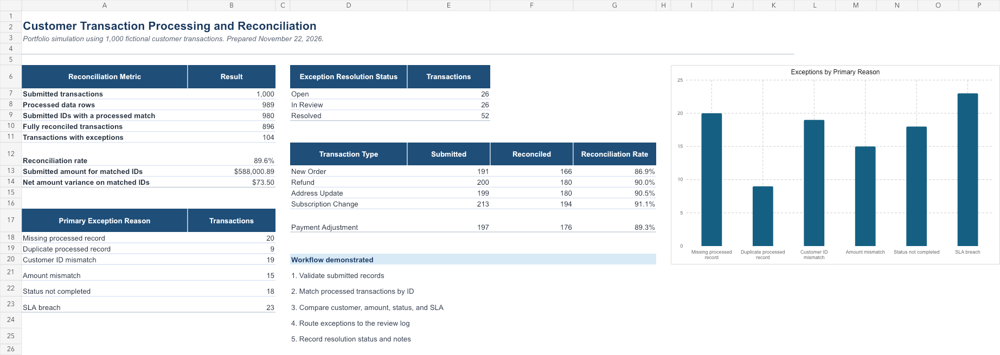
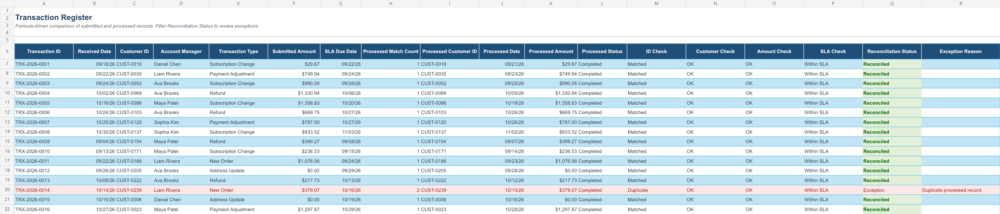
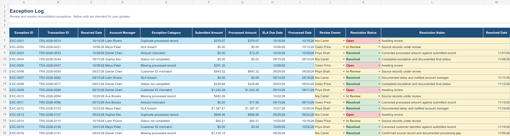

# Customer Transaction Processing and Reconciliation

An Excel portfolio project that simulates a data-operations workflow for validating submitted customer transactions against processed records, identifying exceptions, and documenting their resolution.

All records are synthetic. The workbook contains no real customer or employer data.

## Project objective

The project demonstrates how an operations team can:

- Maintain structured submitted and processed transaction records
- Match transactions using a unique transaction ID
- Detect missing and duplicate processed records
- Compare customer identifiers and transaction amounts
- Check completion status and SLA compliance
- Assign, track, and document reconciliation exceptions
- Summarize processing accuracy and outstanding work

## Workbook

Download [Customer_Transaction_Processing_and_Reconciliation.xlsx](Customer_Transaction_Processing_and_Reconciliation.xlsx) and open it in Microsoft Excel.

The workbook contains five worksheets:

1. **Reconciliation** - control totals, reconciliation metrics, exception categories, resolution status, and results by transaction type
2. **Transaction Register** - formula-driven comparison of submitted and processed records
3. **Exception Log** - review ownership, resolution status, notes, and resolved dates
4. **Submitted Data** - 1,000 fictional customer transaction requests
5. **Processed Data** - simulated processing results containing controlled data-quality exceptions

## Excel skills demonstrated

- `INDEX` and `MATCH` for record retrieval
- `COUNTIF`, `COUNTIFS`, and `SUMIF` for controls and summaries
- Nested `IF` and `OR` logic for exception classification
- Excel tables, filters, and frozen panes
- List-based data validation
- Conditional formatting for reconciliation and workflow status
- Currency, date, percentage, and identifier formatting
- Formula-linked control totals and reporting chart

## Validation rules

A transaction is classified as an exception when any of the following conditions apply:

- The processed match count is not exactly one
- The submitted and processed customer IDs differ
- The submitted and processed amounts differ by at least $0.01
- The processed status is not `Completed`
- The processed date is later than the SLA due date

## Results

| Metric | Result |
| --- | ---: |
| Submitted transactions | 1,000 |
| Processed data rows | 989 |
| Submitted IDs with a processed match | 980 |
| Fully reconciled transactions | 896 |
| Transactions with exceptions | 104 |
| Reconciliation rate | 89.6% |

The 104 primary exceptions consist of 20 missing processed records, 9 duplicate processed records, 19 customer ID mismatches, 15 amount mismatches, 18 incomplete statuses, and 23 SLA breaches.

## Screenshots

### Reconciliation summary

### Transaction register

### Exception log

## Suggested review workflow

1. Compare the submitted and processed source sheets.
2. Open the Transaction Register and filter `Reconciliation Status` to `Exception`.
3. Review the individual validation columns and primary exception reason.
4. Open the Exception Log to inspect ownership, status, notes, and resolution dates.
5. Return to Reconciliation to review the control totals and exception summary.

## Limitations and possible extensions

This project is a static portfolio simulation rather than a production transaction system. Potential extensions include importing monthly files with Power Query, adding refresh controls, maintaining a separate historical exception table, and protecting formula columns from manual edits.

## Disclaimer

This independent portfolio project uses fictional customer transactions for learning and demonstration purposes. It does not represent transaction processing performed for a real employer or client.
